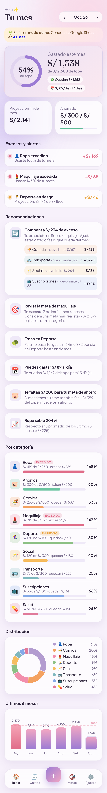
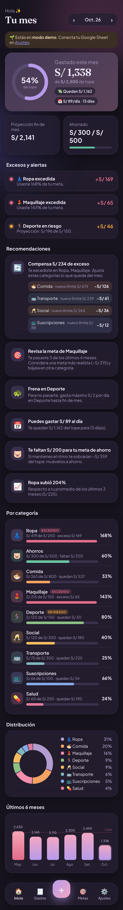
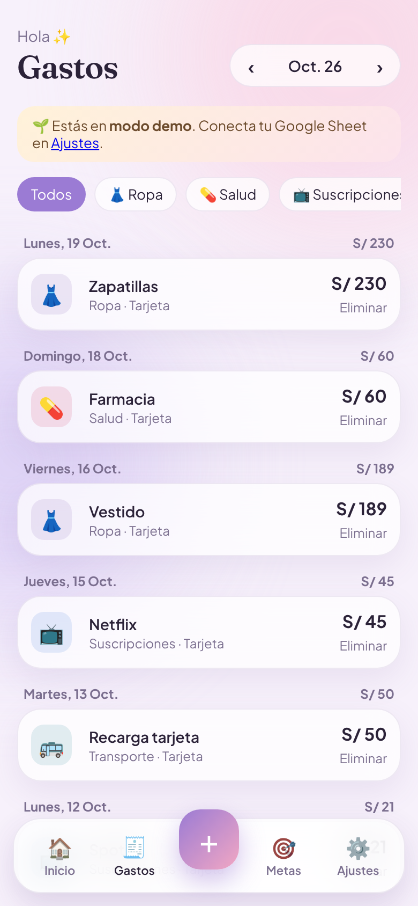
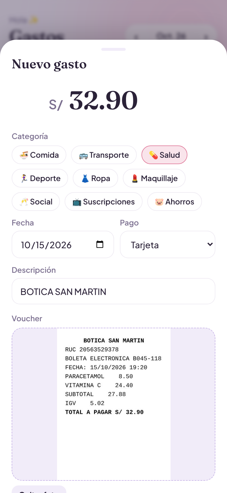
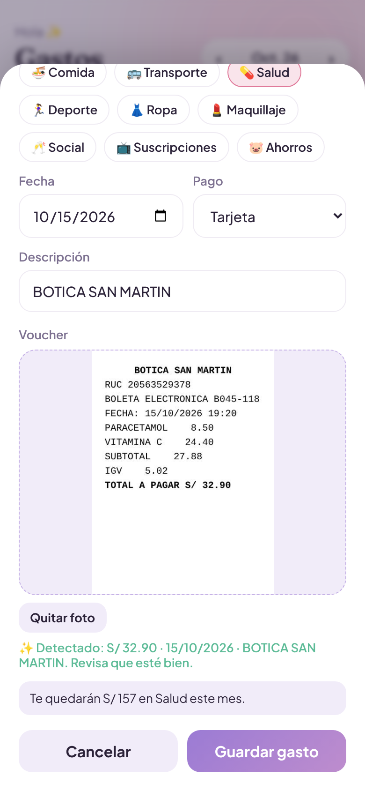
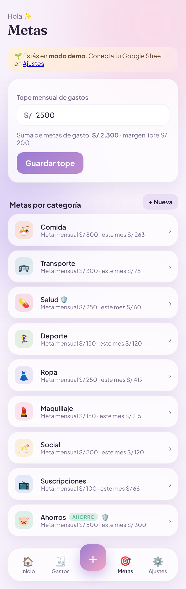
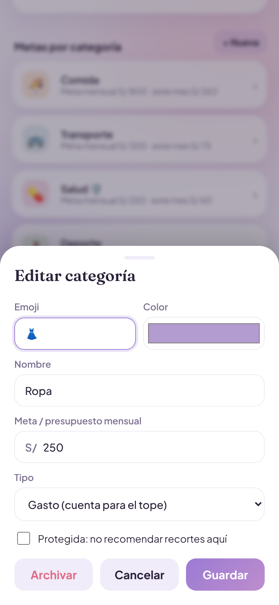
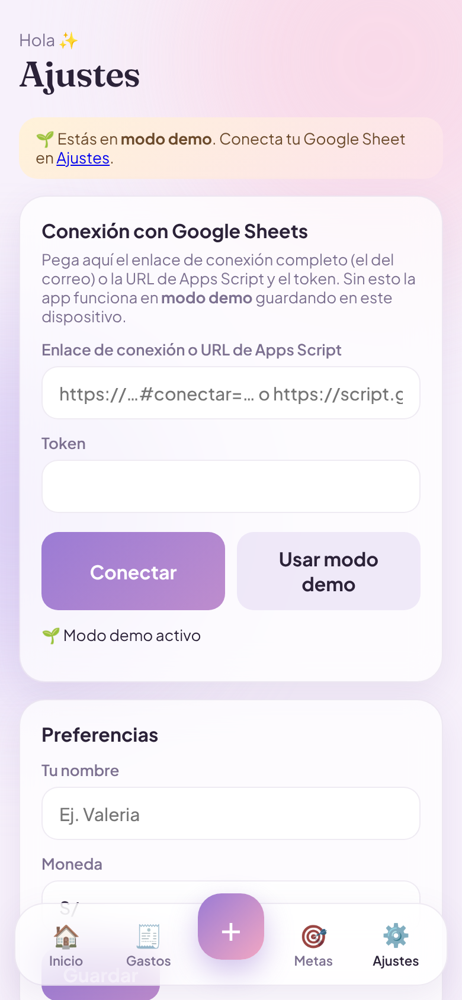
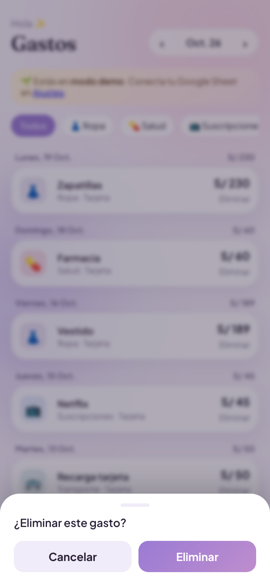

# Mis Gastos — Especificación (Supabase + Vercel → VPS)

Especificación completa para construir **Mis Gastos** en un proyecto nuevo con **Supabase** como backend (base de datos, autenticación y almacenamiento de fotos). Se publica primero en **Vercel** con tu dominio y luego se mueve a tu **VPS**. El diseño, las pantallas, la lógica de recomendaciones y el lector de vouchers son los mismos de la versión con Google Sheets; las capturas están en `capturas/`.

---

## 1. Qué es

App web instalable en el celular (PWA) para **administrar gastos personales**. Cada persona crea su cuenta y ve solo sus datos.

- Registrar gastos por categoría, con **foto del voucher** guardada en Supabase Storage.
- **Lectura automática del voucher** (OCR en el celular): completa monto total, fecha y comercio.
- **Tope mensual** general y **meta mensual por categoría**.
- **Tablero** del mes: % del tope, proyección, gasto diario permitido, avance por categoría, distribución y tendencia de 6 meses.
- **Alertas** de excesos y **recomendaciones** de en qué categorías ajustar para compensar.
- Categorías personalizables (crear, editar, archivar).
- **Varias personas**: cada una con su cuenta; los datos se aíslan con Row Level Security.
- **Modo demo** sin cuenta, con datos de ejemplo en el navegador.

Público: personas no técnicas, principalmente con iPhone. Idioma español (Perú), moneda por defecto `S/`.

---

## 2. Arquitectura

```
iPhone / navegador
   │  PWA estática (HTML/CSS/JS compilado con Vite → carpeta dist/)
   │  Fase 1: Vercel  ·  Fase 2: VPS con Nginx      (mismo dist/, mismo dominio)
   │
   │  supabase-js (HTTPS, sesión del usuario)
   ▼
Supabase (nube)
   ├── Auth: correo + código de 6 dígitos (OTP) o contraseña
   ├── Postgres: settings · categories · expenses   (RLS: cada uno ve lo suyo)
   └── Storage: bucket privado "vouchers"           (URLs firmadas temporales)
```

| Parte | Tecnología | Notas |
|---|---|---|
| Frontend | **Vite + JavaScript sin framework** (módulos ES) | `npm run build` genera `dist/`, que sirve igual en Vercel y en Nginx |
| Cliente de datos | `@supabase/supabase-js` v2 | Usa la **anon key** (es pública por diseño; la seguridad la dan las políticas RLS) |
| Base de datos | Supabase Postgres | Esquema y políticas en §6 |
| Fotos | Supabase Storage, bucket privado `vouchers` | Ruta `<user_id>/<expense_id>.jpg`; se muestran con URL firmada de 1 h |
| Autenticación | Supabase Auth | Recomendado: **código OTP por correo** (ver §10, iPhone) |
| OCR | Tesseract.js 5.1.1, idioma `spa` | Archivos **servidos desde tu propio dominio** (`public/tesseract/`) para no depender de un CDN |
| PWA | `manifest.webmanifest`, íconos PNG 180/192/512, `sw.js` | Service worker red-primero solo para archivos de la app |
| Hosting | Vercel (fase 1) → VPS Ubuntu + Nginx + Certbot (fase 2) | Detalle en §11 y §12 |

**Variables de entorno** (se leen al compilar, no son secretas):

```
VITE_SUPABASE_URL=https://<proyecto>.supabase.co
VITE_SUPABASE_ANON_KEY=<anon key>
```

Nunca uses la `service_role` key en el frontend.

**Estructura del proyecto**

```
mis-gastos/
├── index.html
├── public/
│   ├── manifest.webmanifest, sw.js, icon.svg, icon-192.png, icon-512.png, apple-touch-icon.png
│   └── tesseract/            worker.min.js, tesseract-core*.wasm(.js), spa.traineddata.gz
├── src/
│   ├── main.js               arranque, navegación, render
│   ├── supabase.js           createClient con las variables de entorno
│   ├── auth.js               login OTP / contraseña, logout, sesión
│   ├── api.js                SupabaseBackend + DemoBackend (misma interfaz)
│   ├── insights.js           motor de tablero y recomendaciones (puro)
│   ├── receipt.js            OCR + parser de vouchers (puro)
│   └── styles.css
├── supabase/
│   └── migrations/001_init.sql   esquema, RLS, trigger, storage (§6)
├── tests/                    node --test (insights y receipt)
├── deploy/nginx.conf         configuración del VPS (§12)
├── .github/workflows/deploy-vps.yml
├── vercel.json
└── .env.example
```

---

## 3. Diseño

### 3.1 Dirección visual

Suave, pastel y "aesthetic": fondo lila muy claro con dos manchas difusas (rosa y lavanda), tarjetas de vidrio esmerilado (blanco translúcido + `backdrop-filter: blur`), esquinas muy redondeadas, títulos con serif elegante y números grandes. Modo oscuro automático con la misma paleta en tonos ciruela.

### 3.2 Tokens de color

| Token | Claro | Oscuro | Uso |
|---|---|---|---|
| `--bg` | `#F7F1FB` | `#17141F` | Fondo de página |
| `--surface` | `rgba(255,255,255,.72)` | `rgba(37,31,50,.78)` | Tarjetas (vidrio) |
| `--surface-solid` | `#FFFFFF` | `#241E30` | Hojas modales, inputs |
| `--border` | `rgba(120,90,160,.12)` | `rgba(220,200,255,.10)` | Bordes |
| `--text` | `#2B2238` | `#F2ECFA` | Texto |
| `--muted` | `#7C7090` | `#A99BBF` | Texto secundario |
| `--primary` | `#9B7BD4` | `#B79BEA` | Lila principal |
| `--primary-2` | `#F2A7C3` | `#F2A7C3` | Rosa (degradados) |
| `--ok` | `#5DBB97` | — | Ahorro / éxito |
| `--warn` | `#E9A23B` | — | En riesgo |
| `--danger` | `#E06C88` | — | Excedido |
| `--track` | `rgba(155,123,212,.14)` | `rgba(183,155,234,.16)` | Fondos de barras y botones suaves |
| `--blob-a` / `--blob-b` | `#F9D5E5` / `#D9CCF5` | `#4A2A44` / `#2E2950` | Manchas de fondo (blur 60px) |
| `--radius` | `22px` | | Radio de tarjetas |
| `--shadow` | `0 10px 30px rgba(110,80,150,.10)` | `0 10px 30px rgba(0,0,0,.35)` | Sombra |

Patrón de tema: todos los tokens en `:root`; redefinidos en `@media (prefers-color-scheme: dark) { :root:not([data-theme="light"]) {…} }` y en `:root[data-theme="dark"]`.

Colores de categorías por defecto: Comida `#F4A261`, Transporte `#7FB7BE`, Salud `#E07A9A`, Deporte `#8CC084`, Ropa `#B39CD0`, Maquillaje `#F28FAD`, Social `#F6BD60`, Suscripciones `#84A9E8`, Ahorros `#6CC4A1`.

### 3.3 Tipografía

- **Fraunces** 600 (Google Fonts): títulos de pantalla (30px), monto grande del tablero (32px), monto del formulario (44px), títulos de hojas modales.
- **Plus Jakarta Sans** 400–700: todo lo demás (14–15px cuerpo, 11–13px etiquetas).

### 3.4 Componentes

| Componente | Descripción |
|---|---|
| Encabezado | Saludo pequeño ("Hola, Brunela ✨") + título serif + selector de mes en píldora (‹ Oct. 26 ›) |
| Banner | Aviso de modo demo, degradado amarillo→rosa |
| Tarjeta héroe | Degradado lila→rosa; anillo SVG de progreso (r=52, trazo 11, color cambia a ámbar >85% y rojo >100%), monto gastado, tope y dos chips ("Quedan S/ X", "S/ X/día · N días") |
| Stats | Dos tarjetas: proyección fin de mes (roja si supera el tope) y ahorrado con mini barra verde |
| Alerta | Fila con punto de color con halo (rojo/ámbar), título, detalle y monto "+S/ X" |
| Recomendación | Ícono en cuadro redondeado + título + texto; la de compensación lista recortes por categoría con su "nuevo límite" |
| Fila de categoría | Emoji en cuadro con color de la categoría (22% opacidad), nombre + insignia (EXCEDIDO / EN RIESGO / 80%+ / META ✓), "S/ gastado de S/ meta · quedan/exceso", barra de progreso con marca de proyección, % a la derecha |
| Dona | SVG con `stroke-dasharray` por categoría + leyenda con % |
| Tendencia | Barras de 6 meses con degradado; barra roja si superó el tope; línea punteada "tope"; mes actual resaltado |
| Barra inferior | Flotante, vidrio, 5 columnas: Inicio · Gastos · **+** (botón degradado elevado) · Metas · Ajustes |
| Hoja modal | `<dialog>` que sube desde abajo (bordes 28px arriba), manija, fondo con blur |
| Chips de categoría | Píldoras con borde; la activa se rellena con su color |
| Zona de foto | Recuadro punteado lila; muestra la foto completa (`object-fit: contain`) |
| Aviso de presupuesto | Bajo el formulario: "Te quedarán S/ X en Salud" o en rojo "Con este gasto te excedes…" |
| Toast | Píldora oscura abajo al centro, 2,6 s |
| Confirmación | Hoja modal propia (no `confirm()` del navegador) |

### 3.5 Layout

Mobile-first, ancho máximo 560px centrado, margen lateral 16px, respeta `safe-area-inset`. En pantallas ≤380px el héroe y la dona se apilan.

---

## 4. Pantallas

### Inicio (tablero)



Modo oscuro:



### Gastos

Lista del mes agrupada por día con total diario, filtros por categoría, enlace al voucher y "Eliminar".



### Nuevo gasto (botón +)

Monto grande, chips de categoría, fecha, método de pago (Tarjeta, Efectivo, Yape/Plin, Transferencia), descripción, foto del voucher. Al tomar la foto, el OCR completa los campos vacíos.





### Metas

Tope mensual (muestra suma de metas y margen libre) y lista de categorías.



### Editar categoría

Emoji, color, nombre, meta mensual, tipo (Gasto / Ahorro), "Protegida" y Archivar/Reactivar.



### Cuenta (reemplaza a "Ajustes")

Misma tarjeta y estilo que la captura, pero con: correo de la sesión, **Cerrar sesión**, nombre, moneda, **Exportar CSV del mes** y, en modo demo, "Crear cuenta" y "Reiniciar demo". Ya no hay campos de URL ni token.



### Entrada (nueva, sin captura)

Pantalla centrada con el fondo de manchas: ícono de la app, título serif "Mis Gastos", texto "Entra con tu correo", campo de correo y botón primario **Enviar código**; luego un campo de 6 dígitos y **Entrar**. Debajo, botón suave **Probar sin cuenta**.

### Confirmación



---

## 5. Funciones

1. **Cuenta**: entrar con correo y código de 6 dígitos (o contraseña). La sesión queda guardada; "Cerrar sesión" en Cuenta.
2. **Primera vez**: un trigger crea la configuración (tope S/ 2500, moneda `S/`) y las 9 categorías por defecto.
3. **Registrar gasto**: monto > 0, categoría, fecha, método de pago (Tarjeta, Efectivo, Yape/Plin, Transferencia), descripción, foto opcional. El `id` (UUID) lo genera la app para que un reintento no duplique (`upsert` con `ignoreDuplicates`).
4. **Foto del voucher**: se reduce a 1200 px de lado mayor, JPEG calidad 0,7, y se sube a `vouchers/<user_id>/<expense_id>.jpg`. Al mostrar, se pide una URL firmada.
5. **Lectura automática** (§8): llena monto, fecha y comercio solo si el campo está vacío y muestra "✨ Detectado: … Revisa que esté bien".
6. **Aviso en vivo** al escribir el monto: cuánto quedará en la categoría, si se excede o si supera el tope.
7. **Eliminar gasto** con confirmación propia; también borra la foto de Storage.
8. **Categorías**: crear, editar (renombrar no toca los gastos porque se enlazan por `category_id`), archivar (no borra historial), reactivar. Tipo *gasto* o *ahorro*; *Protegida* = nunca se recomienda recortarla.
9. **Tope mensual**, nombre y moneda en `settings`.
10. **Navegar meses** con ‹ ›; tocar una categoría del tablero abre sus gastos filtrados.
11. **Modo demo** sin cuenta: datos de ejemplo (mes actual + 5 anteriores) en `localStorage`, con la misma interfaz de backend.
12. **PWA instalable**: Safari → Compartir → Agregar a inicio; Android → Instalar app.
13. **Exportar CSV** del mes (opcional, recomendado como reemplazo de "ver en el Excel").

---

## 6. Base de datos Supabase

Pega esto en **SQL Editor** de Supabase (o guárdalo como `supabase/migrations/001_init.sql`).

```sql
-- ============ Tablas ============
create table public.settings (
  user_id      uuid primary key references auth.users on delete cascade,
  monthly_cap  numeric(12,2) not null default 2500 check (monthly_cap >= 0),
  currency     text not null default 'S/',
  display_name text not null default '',
  updated_at   timestamptz not null default now()
);

create table public.categories (
  id             uuid primary key default gen_random_uuid(),
  user_id        uuid not null default auth.uid() references auth.users on delete cascade,
  name           text not null check (length(trim(name)) between 1 and 30),
  emoji          text not null default '✨',
  color          text not null default '#B39CD0' check (color ~ '^#[0-9A-Fa-f]{6}$'),
  monthly_budget numeric(12,2) not null default 0 check (monthly_budget >= 0),
  kind           text not null default 'gasto' check (kind in ('gasto','ahorro')),
  is_protected   boolean not null default false,
  is_active      boolean not null default true,
  sort_order     int not null default 0,
  created_at     timestamptz not null default now(),
  unique (user_id, name),
  unique (id, user_id)            -- permite la FK compuesta de expenses
);

create table public.expenses (
  id             uuid primary key default gen_random_uuid(),
  user_id        uuid not null default auth.uid() references auth.users on delete cascade,
  category_id    uuid not null,
  amount         numeric(12,2) not null check (amount > 0),
  spent_on       date not null,
  description    text not null default '',
  payment_method text not null default 'Tarjeta',
  voucher_path   text,
  created_at     timestamptz not null default now(),
  -- el gasto solo puede apuntar a una categoría del mismo usuario
  foreign key (category_id, user_id) references public.categories (id, user_id) on delete restrict
);
create index expenses_user_date on public.expenses (user_id, spent_on desc);

-- ============ Row Level Security ============
alter table public.settings   enable row level security;
alter table public.categories enable row level security;
alter table public.expenses   enable row level security;

create policy "own settings"   on public.settings   for all
  using (user_id = auth.uid()) with check (user_id = auth.uid());
create policy "own categories" on public.categories for all
  using (user_id = auth.uid()) with check (user_id = auth.uid());
create policy "own expenses"   on public.expenses   for all
  using (user_id = auth.uid()) with check (user_id = auth.uid());

-- ============ Datos iniciales al registrarse ============
create or replace function public.handle_new_user() returns trigger
language plpgsql security definer set search_path = public as $$
begin
  insert into public.settings (user_id) values (new.id);
  insert into public.categories (user_id, name, emoji, color, monthly_budget, kind, is_protected, sort_order) values
    (new.id, 'Comida',        '🍜', '#F4A261', 800, 'gasto',  false, 1),
    (new.id, 'Transporte',    '🚌', '#7FB7BE', 300, 'gasto',  false, 2),
    (new.id, 'Salud',         '💊', '#E07A9A', 250, 'gasto',  true,  3),
    (new.id, 'Deporte',       '🏃‍♀️', '#8CC084', 150, 'gasto',  false, 4),
    (new.id, 'Ropa',          '👗', '#B39CD0', 250, 'gasto',  false, 5),
    (new.id, 'Maquillaje',    '💄', '#F28FAD', 150, 'gasto',  false, 6),
    (new.id, 'Social',        '🥂', '#F6BD60', 300, 'gasto',  false, 7),
    (new.id, 'Suscripciones', '📺', '#84A9E8', 100, 'gasto',  false, 8),
    (new.id, 'Ahorros',       '🐷', '#6CC4A1', 500, 'ahorro', true,  9);
  return new;
end $$;

create trigger on_auth_user_created
  after insert on auth.users
  for each row execute function public.handle_new_user();

-- ============ Storage: fotos de vouchers ============
insert into storage.buckets (id, name, public) values ('vouchers', 'vouchers', false)
  on conflict (id) do nothing;

create policy "read own vouchers" on storage.objects for select to authenticated
  using (bucket_id = 'vouchers' and (storage.foldername(name))[1] = auth.uid()::text);
create policy "upload own vouchers" on storage.objects for insert to authenticated
  with check (bucket_id = 'vouchers' and (storage.foldername(name))[1] = auth.uid()::text);
create policy "delete own vouchers" on storage.objects for delete to authenticated
  using (bucket_id = 'vouchers' and (storage.foldername(name))[1] = auth.uid()::text);
```

**Adaptador para el motor de recomendaciones.** `insights.js` trabaja con nombres de categoría; `api.js` convierte las filas así, y el motor queda idéntico:

| Motor (`insights.js`) | Supabase |
|---|---|
| `config.tope_mensual`, `config.moneda`, `config.nombre` | `settings.monthly_cap`, `currency`, `display_name` |
| `category.name, emoji, color, budget, type, active, protected` | `name, emoji, color, monthly_budget, kind, is_active, is_protected` |
| `expense.id, date, amount, category (nombre), description, payment, voucher` | `id, spent_on, amount, categories.name, description, payment_method, voucher_path` |

**Interfaz de `api.js`** (igual para `SupabaseBackend` y `DemoBackend`): `getAll()`, `addExpense(expense, photo)`, `deleteExpense(id)`, `saveCategory(category, originalId?)`, `archiveCategory(id)`, `saveConfig(config)`, `voucherUrl(path)`.

Consultas clave:

```js
// Cargar todo (últimos 13 meses)
const desde = /* primer día de hace 12 meses, 'YYYY-MM-DD' */;
const [s, c, e] = await Promise.all([
  supabase.from('settings').select('*').single(),
  supabase.from('categories').select('*').order('sort_order'),
  supabase.from('expenses').select('*, categories(name)').gte('spent_on', desde).order('spent_on', { ascending: false }),
]);

// Guardar gasto con foto (id generado en el cliente → reintento seguro)
const id = crypto.randomUUID();
let voucher_path = null;
if (photo) {
  voucher_path = `${user.id}/${id}.jpg`;
  await supabase.storage.from('vouchers').upload(voucher_path, photo.blob, { contentType: 'image/jpeg', upsert: true });
}
await supabase.from('expenses').upsert({ id, category_id, amount, spent_on, description, payment_method, voucher_path },
  { onConflict: 'id', ignoreDuplicates: true });

// Mostrar foto
const { data } = await supabase.storage.from('vouchers').createSignedUrl(path, 3600);
```

---

## 7. Lógica del tablero y recomendaciones (`insights.js`, funciones puras)

Entrada: `{config, categories, expenses}`, mes `YYYY-MM`, fecha de hoy.

**Por categoría**
- `spent` = suma del mes; `projected` = `spent × díasDelMes / díasTranscurridos` (solo mes en curso, tipo gasto, y **no** para Suscripciones).
- Estado:
  - ahorro → `goal` si `spent ≥ meta`, si no `saving`.
  - `exceeded` si `spent > meta`.
  - `risk` si mes en curso, `projected > meta × 1,05` y quedan > 2 días.
  - `warning` si `spent ≥ 80%` de la meta.
- Gastos en categorías inexistentes se muestran igual (sin meta → excedidos).

**Totales**: gastado (solo tipo gasto), proyección, suma de metas, ahorrado, meta de ahorro, disponible = tope − gastado, **por día** = disponible / días restantes (incluye hoy).

**Alertas**: tope superado; "a este ritmo superarás tu tope"; cada categoría excedida (+exceso); cada categoría en riesgo (+proyección − meta).

**Recomendaciones** (en este orden):
1. **Compensar exceso**: exceso total de categorías excedidas se reparte entre "donantes" = categorías tipo gasto, no protegidas, no excedidas, con meta, cuya holgura `meta − max(gastado, proyección)` > 0, **proporcional a su holgura**. Lista "−S/ X · nuevo límite S/ Y". Si no alcanza, muestra lo no cubierto.
2. **Revisar meta**: categoría excedida que también se excedió en ≥ 2 de los 3 meses anteriores.
3. **Frena en X**: para categorías en riesgo, máximo por día = (meta − gastado) / días restantes.
4. **Puedes gastar S/ X al día** (mes en curso con saldo).
5. **Metas > tope**: si la suma de metas supera el tope.
6. **Ahorro pendiente**: lo que falta para la meta de ahorro y cuánto sobraría del tope.
7. **Tendencia**: la categoría que más subió (> 25%) vs el promedio de los 3 meses anteriores.
8. Si no hay nada: "¡Vas excelente!".

---

## 8. Lector de vouchers (`receipt.js`)

- `parseAmount`: entiende `45.90`, `45,90`, `1,234.50`, `1.234,50`, `S/ 1,250`.
- **Monto**: líneas con "total / a pagar / importe", excluyendo subtotal, descuento, vuelto, cambio, gravada, IGV, "op."; prioridad a "total a pagar / importe total / total pagado / monto total"; si la línea no tiene número, mira la siguiente. Sin "total" → el mayor monto con 2 decimales.
- **Fecha**: `dd/mm/aaaa`, `dd-mm-aa` o `aaaa-mm-dd`, válida y no más de 1 día en el futuro.
- **Comercio**: primera línea con ≥ 4 letras y mayoría de letras, sin RUC/boleta/factura/fecha/ticket/electrónica (máx. 40 caracteres).

Para servir Tesseract desde tu dominio: copia `node_modules/tesseract.js/dist/worker.min.js`, los `tesseract-core*.wasm(.js)` de `tesseract.js-core` y `spa.traineddata.gz` de `@tesseract.js-data/spa/4.0.0_best_int` a `public/tesseract/`, y crea el worker con:

```js
Tesseract.createWorker('spa', 1, {
  workerPath: '/tesseract/worker.min.js',
  corePath: '/tesseract/',
  langPath: '/tesseract/',
});
```

---

## 9. Autenticación

- **Método recomendado: código de 6 dígitos por correo** (`signInWithOtp({ email, options: { shouldCreateUser: true } })` y luego `verifyOtp({ email, token, type: 'email' })`). En la plantilla de correo de Supabase (Authentication → Email Templates → Magic Link) incluye `{{ .Token }}` para que llegue el código.
- Alternativa: correo + contraseña (`signUp` / `signInWithPassword`) con "Olvidé mi contraseña".
- Pantalla de entrada con el mismo estilo: logo, "Entra con tu correo", campo de correo → campo de código → listo. Botón secundario "Probar sin cuenta (demo)".
- `persistSession: true` (por defecto): la sesión queda en el dispositivo.
- Configura en Supabase **Authentication → URL Configuration**: *Site URL* = tu dominio, y en *Redirect URLs* agrega `http://localhost:5173`, tu dominio y las URLs de Vercel.
- Correo: el SMTP incluido en Supabase tiene un límite bajo de envíos; para producción configura un SMTP propio (por ejemplo Resend o el de tu dominio) en Authentication → SMTP.

---

## 10. Lecciones aprendidas que aplican

| Tema | Qué hacer |
|---|---|
| **iPhone: enlace mágico** | Un enlace por correo se abre en Safari, no en la app instalada, y la sesión no pasa a la app. Por eso se usa **código de 6 dígitos** que se escribe dentro de la app. |
| iPhone: almacenamiento | La app instalada en la pantalla de inicio tiene su propio almacenamiento: hay que iniciar sesión dentro de la app instalada, no solo en Safari. |
| `confirm()` | No usar diálogos del navegador; usar una hoja modal propia. |
| Ícono en iPhone | iOS necesita `apple-touch-icon` en **PNG 180×180**, no SVG. |
| Service worker | Servir `sw.js` e `index.html` **sin caché** para que las actualizaciones lleguen; los archivos con hash de Vite, con caché larga. |
| Fotos pesadas | Comprimir en el celular antes de subir (1200 px, JPEG 0,7 → ~100–200 KB). |
| OCR | Llenar solo campos vacíos y pedir siempre revisar el monto. |
| Supabase gratis | Los proyectos del plan gratuito se pausan tras un periodo sin uso; revisa la política vigente o usa un plan pago para producción. |

---

## 11. Publicación fase 1: Vercel con tu dominio

1. Sube el proyecto a GitHub.
2. En [vercel.com](https://vercel.com) → **Add New → Project** → importa el repositorio.
   - Framework: **Vite** · Build: `npm run build` · Output: `dist`.
3. **Settings → Environment Variables**: `VITE_SUPABASE_URL` y `VITE_SUPABASE_ANON_KEY` (Production y Preview) → **Redeploy**.
4. **Settings → Domains** → agrega `gastos.tudominio.com` (o el que uses). En el DNS de tu dominio crea el registro que Vercel indique (normalmente un **CNAME** hacia Vercel para un subdominio, o un **A** para el dominio raíz).
5. En Supabase → Authentication → URL Configuration: *Site URL* = `https://gastos.tudominio.com`.

`vercel.json`:

```json
{
  "headers": [
    { "source": "/sw.js", "headers": [{ "key": "Cache-Control", "value": "no-cache" }] },
    { "source": "/index.html", "headers": [{ "key": "Cache-Control", "value": "no-cache" }] },
    { "source": "/assets/(.*)", "headers": [{ "key": "Cache-Control", "value": "public, max-age=31536000, immutable" }] },
    { "source": "/tesseract/(.*)", "headers": [{ "key": "Cache-Control", "value": "public, max-age=2592000" }] }
  ]
}
```

---

## 12. Publicación fase 2: tu VPS

Como la app es estática (`dist/`), en el VPS solo hace falta **Nginx + HTTPS**. Supabase sigue en la nube, sin cambios.

**Una sola vez en el VPS (Ubuntu 22.04/24.04)**

```bash
sudo apt update && sudo apt install -y nginx certbot python3-certbot-nginx
sudo mkdir -p /var/www/mis-gastos && sudo chown $USER /var/www/mis-gastos
```

`/etc/nginx/sites-available/mis-gastos` (también en `deploy/nginx.conf`):

```nginx
server {
  listen 80;
  server_name gastos.tudominio.com;
  root /var/www/mis-gastos;
  index index.html;

  location = /sw.js      { add_header Cache-Control "no-cache"; }
  location = /index.html { add_header Cache-Control "no-cache"; }
  location /assets/      { add_header Cache-Control "public, max-age=31536000, immutable"; }
  location /tesseract/   { add_header Cache-Control "public, max-age=2592000"; }
  location ~* \.wasm$    { types { application/wasm wasm; } }

  location / { try_files $uri $uri/ /index.html; }

  gzip on;
  gzip_types text/css application/javascript application/json image/svg+xml application/wasm;
}
```

```bash
sudo ln -s /etc/nginx/sites-available/mis-gastos /etc/nginx/sites-enabled/
sudo nginx -t && sudo systemctl reload nginx
sudo certbot --nginx -d gastos.tudominio.com      # HTTPS gratis y renovación automática
```

**Despliegue automático con GitHub Actions** (`.github/workflows/deploy-vps.yml`):

```yaml
name: Deploy VPS
on:
  push:
    branches: [main]
  workflow_dispatch:
jobs:
  deploy:
    runs-on: ubuntu-latest
    steps:
      - uses: actions/checkout@v4
      - uses: actions/setup-node@v4
        with: { node-version: 20 }
      - run: npm ci && npm test && npm run build
        env:
          VITE_SUPABASE_URL: ${{ secrets.VITE_SUPABASE_URL }}
          VITE_SUPABASE_ANON_KEY: ${{ secrets.VITE_SUPABASE_ANON_KEY }}
      - name: Subir dist/ al VPS
        run: |
          install -m 600 -D /dev/null ~/.ssh/id_ed25519
          echo "${{ secrets.VPS_SSH_KEY }}" > ~/.ssh/id_ed25519
          ssh-keyscan -H ${{ secrets.VPS_HOST }} >> ~/.ssh/known_hosts
          rsync -az --delete dist/ ${{ secrets.VPS_USER }}@${{ secrets.VPS_HOST }}:/var/www/mis-gastos/
```

Secrets del repositorio: `VITE_SUPABASE_URL`, `VITE_SUPABASE_ANON_KEY`, `VPS_HOST`, `VPS_USER`, `VPS_SSH_KEY` (llave privada de un usuario con permiso de escritura en `/var/www/mis-gastos`).

**Cambio de Vercel al VPS sin cortar el servicio**

1. Con el VPS ya sirviendo y con HTTPS, prueba antes de cambiar el DNS: `curl -H "Host: gastos.tudominio.com" http://IP_DEL_VPS/`. Certbot puede requerir el DNS apuntando al VPS; si es así, haz el paso 2 primero y ejecuta certbot enseguida.
2. En el DNS, cambia el registro de `gastos.tudominio.com` a un **A** con la IP del VPS (baja el TTL a 300 s un día antes).
3. Quita el dominio en Vercel cuando el DNS ya apunte al VPS.
4. Supabase no cambia si el dominio es el mismo. Si cambias de dominio, actualiza *Site URL* y *Redirect URLs*.
5. Las personas no tienen que reinstalar: la app instalada sigue en el mismo dominio y el service worker toma la versión nueva.

---

## 13. Prompt para recrearla con una IA de código

> Construye una PWA en español llamada "Mis Gastos" para administrar gastos personales con **Vite + JavaScript sin framework** y **Supabase** (Auth con código OTP de 6 dígitos por correo, Postgres con RLS y Storage privado para fotos de vouchers). Sigue exactamente `ESPECIFICACION-SUPABASE.md`: diseño y tokens de §3, pantallas de §4 con las capturas de `capturas/` (la pantalla Ajustes se reemplaza por Cuenta y se agrega la pantalla de entrada), funciones de §5, esquema SQL y adaptador de §6, motor de recomendaciones de §7 sin cambios, lector de vouchers de §8 con Tesseract servido desde `public/tesseract/`, autenticación de §9. Incluye modo demo sin cuenta, tests con `node --test` para `insights.js` y `receipt.js`, `vercel.json`, `deploy/nginx.conf` y el workflow de GitHub Actions de §12.
